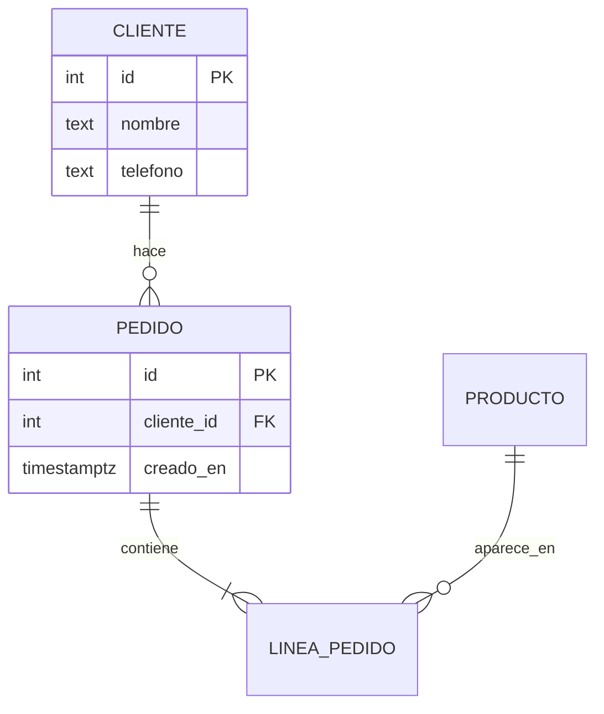

# PRD · <Galeria con Filtros de Imagen>

> Documento de requisitos del producto (Product Requirements Document).
> Complétalo en el Sprint 0 (historia H0.3) y pide la aprobación del profesor en un Issue.
> Cada requisito funcional (RF) se convierte en un Issue con la plantilla "Historia de usuario".

| Campo               | Valor                        |
| ------------------- | ---------------------------- |
| Alumno              | Adrian Mendez                |
| Proyecto n.º        | 26                           |
| Sitio de referencia |                              |
| Compañero revisor   | Anayerlis Chacoa             |
| URL desplegada      | (se completa en el Sprint 5) |

## 1. Problema

¿Qué problema real resuelve y a quién le duele? (3 a 5 líneas)
Los creadores de contenido, diseñadores y usuarios generales suelen acumular cientos de imagenes sin una estructura clara de clasificacion, lo que dificultad encontrar referencias visualesespecificas de forma rapida. Navegar por carpetas locales o feeds interminables sin criterios de búsqueda genera pérdida de tiempo y frustración. Esta aplicación resuelve la desorganización visual ofreciendo una galería centralizada que permite filtrar y ubicar fotografías al instante según sus atributos.

## 2. Usuarios

- **Usuario principal:** quién es, qué necesita, desde qué dispositivo entra.
  Creador digital, diseñador o estudiante que necesita explorar, organizar y encontrar referencias fotográficas específicas rápidamente; accede principalmente desde navegador web de escritorio o teléfono móvil.
- **Usuario secundario:**
  Administrador o curador de contenido encargado de subir nuevas fotografías, asignarles etiquetas/categorías y mantener actualizado el catálogo de la galería.

## 3. Objetivo y métrica de éxito

Ejemplo: «Un bodeguero registra una venta en menos de 10 segundos».
Permitir que cualquier usuario encuentre y visualice una fotografía específica dentro de la galería aplicando filtros combinados en menos de 10 segundos.

## 4. Alcance del MVP

Entre 5 y 8 funcionalidades que SÍ entran este semestre.

1.Visualización en cuadrícula (Grid) responsiva:_ Mostrar las fotografías cargadas en un diseño adaptable a pantallas de escritorio y móviles.
2.Filtrado por categoría:_ Permitir filtrar las fotos en tiempo real según categorías predefinidas (ej. naturaleza, arquitectura, retratos, tecnología).
3.Búsqueda por texto o etiquetas (tags):\* Barra de búsqueda para localizar imágenes por título, descripción o palabras clave.

### Funcionalidades → carpetas de `src/` (screaming architecture)

Cada funcionalidad del alcance será una carpeta en `src/`. Nómbralas en inglés y en plural.

| Funcionalidad                     | Carpeta           |
| --------------------------------- | ----------------- |
| Ejemplo: ventas                   | `src/sales`       |
|                                   |                   |
| Visualización de galería          | src/gallery       |
| Filtrado por categoría y búsqueda | src/filters       |
| Vista de detalle de foto          | src/photo-details |
| Carga y gestión de fotos          | src/uploads       |

## 5. Fuera de alcance

Lo que NO vas a construir.

-- Edición avanzada de imágenes (recortes, curvas de color, capas o filtros tipo editor profesional).

- Red social completa con seguidores, comentarios, mensajería directa o sistema de "me gusta" en tiempo real.
- Reconocimiento facial o etiquetado automático mediante inteligencia artificial.
- Almacenamiento ilimitado o compresión pesada personalizada en servidor propio más allá de lo básico del MVP.

## 6. Requisitos funcionales

| ID    | Requisito                                                                                                         | Prioridad (alta, media, baja) |
| ----- | ----------------------------------------------------------------------------------------------------------------- | ----------------------------- |
| RF-01 |                                                                                                                   |                               |
| RF-02 |                                                                                                                   |                               |
| ID    | Requisito                                                                                                         | Prioridad (alta, media, baja) |
| ---   | ---                                                                                                               | ---                           |
| RF-01 | Listar fotografías en una cuadrícula responsiva con información básica (título, categoría, miniatura).            | alta                          |
| RF-02 | Filtrar fotografías en tiempo real por categoría seleccionada.                                                    | alta                          |
| RF-03 | Buscar fotografías por texto (título o etiquetas/tags) y combinar con el filtro de categoría.                     | alta                          |
| RF-04 | Limpiar o restablecer todos los filtros activos con una sola acción.                                              | media                         |
| RF-05 | Abrir una foto en vista ampliada (modal o vista de detalle) mostrando metadatos completos.                        | media                         |
| RF-06 | Registrar/subir una nueva fotografía validando campos obligatorios (título, URL o archivo, categoría, etiquetas). | alta                          |

## 7. Requisitos no funcionales

- Responsive, móvil primero (375 px y 1280 px).
- Lighthouse ≥ 90 en Accesibilidad y Buenas prácticas.
- 0 errores en la consola del navegador.
- Funciona con 10.000 registros sin congelarse.

## 8. Modelo de datos

Diagrama entidad-relación y tablas PostgreSQL con tipos, claves y restricciones.
GitHub dibuja diagramas Mermaid; edita este ejemplo:



```mermaid
erDiagram
    CATEGORIA ||--o{ FOTO : clasifica
    FOTO ||--o{ FOTO_ETIQUETA : tiene
    ETIQUETA ||--o{ FOTO_ETIQUETA : agrupa

    CATEGORIA {
        int id PK
        text nombre
        text slug
    }
    FOTO {
        int id PK
        int categoria_id FK
        text titulo
        text descripcion
        text url_imagen
        text autor
        timestamptz creado_en
    }
    ETIQUETA {
        int id PK
        text nombre
    }
    FOTO_ETIQUETA {
        int foto_id FK
        int etiqueta_id FK
    }
## 9. Reto técnico distintivo

El que te tocó en el catálogo y cómo piensas resolverlo.

Mantener la filtración y búsqueda de fotos fluida y sin congelamientos al trabajar con grandes volúmenes de registros (hasta 10.000+ fotos) combinando filtros múltiples (categoría + etiquetas + texto). Lo resolveré aplicando paginación o carga incremental en el frontend, debouncing en la barra de búsqueda y consultas filtradas/indexadas en PostgreSQL en lugar de filtrar todo en memoria sin control.

## 10. Riesgos y preguntas abiertas
Riesgo de rendimiento con muchos datos: Si se cargan miles de imágenes sin paginación ni lazy loading, el navegador puede lentificarse o consumir demasiada memoria.
​Imágenes rotas o enlaces externos caídos: Si las fotos dependen de URLs externas, alguna podría fallar al cargar; habrá que manejar estados de error y una imagen de respaldo (fallback).
-
```
